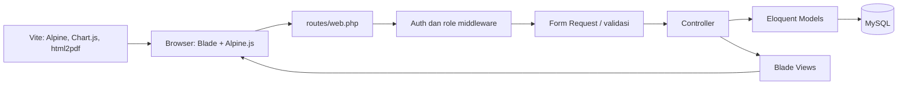

# SITOKO2

SITOKO2 (**Sistem Toko**) adalah aplikasi web untuk operasional toko retail. Aplikasi menggabungkan Point of Sale (POS/kasir), pengelolaan inventaris, pembelian dari supplier, retur, shift, dan laporan dalam satu sistem.

SITOKO ditujukan untuk admin/pemilik toko yang mengelola katalog dan operasional, serta kasir yang mencatat transaksi harian. Data transaksi dan perubahan stok disimpan di MySQL; antarmuka menggunakan Blade dan Alpine.js.

## Daftar Isi

- [Ringkasan](#ringkasan)
- [Fitur](#fitur)
- [Peran dan Akses](#peran-dan-akses)
- [Cara Kerja](#cara-kerja)
- [Workflow Operasional](#workflow-operasional)
- [Teknologi](#teknologi)
- [Struktur Proyek](#struktur-proyek)
- [Prasyarat](#prasyarat)
- [Instalasi di Windows dengan Laragon](#instalasi-di-windows-dengan-laragon)
- [Instalasi dari Terminal](#instalasi-dari-terminal)
- [Akun Awal dan Konfigurasi](#akun-awal-dan-konfigurasi)
- [Menjalankan Aplikasi](#menjalankan-aplikasi)
- [Perintah Pengembangan](#perintah-pengembangan)
- [Testing dan Kualitas Kode](#testing-dan-kualitas-kode)
- [Produksi dan Deployment](#produksi-dan-deployment)
- [Troubleshooting](#troubleshooting)
- [Catatan Implementasi](#catatan-implementasi)
- [Lisensi](#lisensi)

## Ringkasan

| Komponen | Teknologi |
|---|---|
| Backend | PHP 8.3, Laravel 13 |
| Database | MySQL 8.4 |
| UI | Blade, Alpine.js, CSS |
| Asset build | Vite, Node.js, npm |
| Grafik | Chart.js |
| Export | CSV, DomPDF, html2pdf.js |
| Tes | PHPUnit, Laravel Feature Tests |

### Tujuan utama

- Mencatat transaksi penjualan dan memperbarui stok secara atomik.
- Mengelola produk, supplier, brand, dan pergerakan stok.
- Melacak pesanan pembelian, penerimaan parsial/penuh, serta pembayaran supplier.
- Mengelola staf dan shift kasir.
- Menyediakan ringkasan performa toko dan ekspor laporan.

## Fitur

| Modul | Kemampuan |
|---|---|
| Dashboard | Ringkasan penjualan hari ini, staf bertugas, stok menipis/habis, dan produk terlaris. |
| POS / Transaksi | Pencarian produk, keranjang, metode pembayaran, uang tunai/kembalian, modal sukses, dan struk. |
| Inventaris | Daftar dan pencarian produk, kategori, brand, supplier, status stok, harga, stok, dan tanggal kedaluwarsa. SKU produk baru dibuat otomatis. |
| Purchase Order | Membuat dan mengubah PO draft, konfirmasi pesanan, penerimaan barang parsial/penuh, dan PDF. |
| Pembayaran PO | Pembayaran lunas atau uang muka (DP), status unpaid/partial/paid, dan pelunasan. |
| Retur Supplier | Membuat retur dari PO yang diterima, konfirmasi pengurangan stok, penyelesaian pengiriman, atau pembatalan draft. |
| Supplier & Brand | Data supplier, status aktif, hubungan supplier-brand, dan pemilihan supplier untuk produk. |
| Staf & Shift | Akun kasir, status akun, jadwal/shift, clock-in/clock-out, activity log, dan performa kasir. |
| Laporan | Ringkasan penjualan, profit, produk/kategori teratas, pergerakan stok, performa kasir/shift, rentang tanggal, dan ekspor. |
| Pengaturan | Metode pembayaran dan profil toko. |
| Notifikasi | Notifikasi transaksi baru untuk admin dan status baca. |

## Peran dan Akses

- **Admin** mengelola inventaris, PO, supplier, brand, retur, staf, laporan, pengaturan, dan transaksi. Admin dapat membatalkan (void) transaksi yang selesai.
- **Kasir** mengakses proses penjualan dan riwayat/struk transaksi miliknya sendiri. Kasir harus memiliki shift aktif untuk membuat transaksi.
- Route yang memerlukan hak admin dilindungi middleware `role:admin`. Registrasi akun dibatasi untuk admin; akun kasir dibuat melalui pengelolaan staf.
- Role `supervisor` tersedia pada skema user, tetapi belum memiliki kumpulan hak akses khusus yang terpisah seperti admin dan kasir.

## Cara Kerja

Aplikasi menggunakan pola MVC Laravel:



Alur umum sebuah request:

1. Browser meminta route dari `routes/web.php`.
2. Middleware memeriksa autentikasi dan, untuk route tertentu, role pengguna.
3. Controller memvalidasi input, menjalankan query atau transaksi database, lalu mengirim data ke Blade atau JSON.
4. Eloquent mengakses MySQL. Operasi yang mengubah stok menggunakan transaksi database dan row lock agar stok serta catatan transaksi tetap konsisten saat ada request bersamaan.
5. Blade merender halaman. Alpine.js mengatur interaksi seperti dropdown, filter, dan modal.
6. Vite membundel JavaScript. Chart.js dimuat pada halaman yang membutuhkan grafik; html2pdf dimuat saat ekspor PDF diminta.

## Workflow Operasional

### 1. Login dan persiapan kasir

1. Admin membuat akun kasir dari halaman Staf.
2. Pengguna masuk melalui halaman login.
3. Kasir melakukan clock-in manual atau auto clock-in apabila syarat verifikasi email terpenuhi.
4. Kasir harus memiliki shift aktif untuk memproses transaksi.
5. Setelah selesai bekerja, kasir melakukan clock-out untuk menutup shift dan mencatat ringkasan shift.

### 2. Penjualan POS

1. Kasir mencari dan menambahkan produk yang stoknya tersedia ke keranjang.
2. Kasir memilih metode pembayaran dan mengisi nominal bila menggunakan tunai.
3. Server memvalidasi item, jumlah, metode pembayaran, shift aktif, kecukupan stok, dan pembayaran.
4. Dalam transaksi database, sistem mengunci produk, mengurangi stok, membuat transaksi berstatus `completed`, menyimpan snapshot harga beli/jual dan item, lalu mengirim notifikasi ke admin.
5. Kasir melihat ringkasan sukses, dapat mencetak struk, atau memulai transaksi baru.
6. Admin dapat melakukan void pada transaksi completed. Sistem mengembalikan stok dan mengubah status menjadi `voided` dalam transaksi database.

### 3. Pengadaan dan Purchase Order

```mermaid
stateDiagram-v2
    [*] --> draft
    draft --> ordered: Konfirmasi pesanan
    draft --> cancelled: Batalkan
    ordered --> ordered: Penerimaan parsial
    ordered --> received: Semua item diterima
    ordered --> cancelled: Batalkan
```

1. Admin memilih supplier dan menambahkan produk, jumlah, serta harga beli.
2. PO disimpan sebagai `draft`; selama draft, PO dapat diedit.
3. Admin mengonfirmasi PO menjadi `ordered`.
4. Barang dapat diterima bertahap. Setiap penerimaan menambahkan stok dan memperbarui harga beli rata-rata.
5. Status tetap `ordered` selama masih ada barang tersisa; status menjadi `received` ketika seluruh jumlah diterima.
6. PO draft/ordered dapat dibatalkan. PO received tidak dapat dibatalkan.

Pembayaran PO berjalan terpisah dari penerimaan stok:

- `unpaid` → pembayaran penuh → `paid`.
- `unpaid` → DP → `partial` → pelunasan → `paid`.

### 4. Retur Supplier

1. Admin membuat retur dari PO berstatus `received` dengan barang yang masih dapat diretur.
2. Retur dibuat berstatus `draft`.
3. Saat dikonfirmasi, sistem memeriksa stok tersedia, mengurangi stok, dan mengubah status menjadi `confirmed`.
4. Setelah barang diserahkan/dikirim kembali, admin menandai retur `completed`.
5. Retur draft dapat dibatalkan menjadi `cancelled`.

### 5. Inventaris

1. Admin membuat produk, mengisi kategori, satuan, harga, stok awal, dan informasi supplier/brand.
2. SKU dibuat otomatis dari informasi kategori, brand, supplier, dan tanggal; suffix digunakan untuk menghindari duplikasi.
3. Admin dapat mengubah detail/stok atau menggunakan tindakan restock.
4. Sistem mengidentifikasi stok menipis berdasarkan threshold dan stok habis saat kuantitas nol.
5. Produk dengan riwayat transaksi, PO, atau retur dilindungi dari penghapusan.

### 6. Laporan

Admin memilih rentang tanggal atau filter, lalu meninjau agregat penjualan, profit, produk/kategori, staf, shift, dan inventaris. Grafik memakai Chart.js; PDF dashboard menggunakan html2pdf yang baru dimuat ketika tombol ekspor digunakan. Fitur ekspor laporan kustom menyediakan CSV/PDF.

## Teknologi

- **PHP `^8.3`** dan **Laravel `^13.8`**.
- **MySQL 8.4** sebagai database runtime. Seeder menggunakan sintaks MySQL (`SET FOREIGN_KEY_CHECKS=0`), sehingga SQLite bukan database runtime yang didukung untuk proses seeding aplikasi.
- **Blade** sebagai server-rendered UI dan **Alpine.js** untuk interaksi ringan.
- **Vite** membangun asset frontend dari `resources/` ke `public/build/`.
- **Chart.js** dan **html2pdf.js** adalah paket npm; pemakaian grafik/PDF dipecah ke dynamic import.
- **barryvdh/laravel-dompdf** untuk dokumen PDF sisi server dan **maatwebsite/excel** untuk kebutuhan spreadsheet.

## Struktur Proyek

```text
app/
  Http/Controllers/     Controller dan logika request
  Http/Requests/        Validasi input
  Http/Middleware/      Pemeriksaan role
  Listeners/            Aksi setelah event, termasuk auto clock-in
  Models/               Model Eloquent dan relasi
  Notifications/        Notifikasi database
  Console/Commands/     Perintah maintenance
resources/
  js/                   Entry point dan modul JS Vite
  views/pages/          Halaman aplikasi Blade
  views/components/     Komponen Blade bersama
routes/
  web.php               Route aplikasi dan grup auth/admin
  auth.php              Route autentikasi
  console.php           Jadwal command
database/
  migrations/           Skema database
  seeders/              Data awal
  schema/               Schema dump MySQL
 tests/
  Feature/              Pengujian alur HTTP/domain
  Unit/                 Pengujian unit
```

## Prasyarat

- PHP 8.3 dengan ekstensi: `openssl`, `mbstring`, `curl`, `fileinfo`, `pdo_mysql`, `sqlite3`, `zip`, `gd`, `intl`.
- MySQL 8.4 berjalan dan dapat diakses di `127.0.0.1:3306`.
- Composer 2.
- Node.js dan npm yang kompatibel dengan versi Vite dalam `package-lock.json`.
- Git untuk clone repository.

## Instalasi di Windows dengan Laragon

### 1. Siapkan Laragon

1. Install/jalankan Laragon dengan PHP 8.3 dan MySQL 8.4.
2. Start MySQL dari Laragon.
3. Pastikan ekstensi PHP pada bagian Prasyarat aktif.
4. Clone repository ke direktori proyek, misalnya `C:\laragon\www\SITOKO2`.

Buka terminal Laragon atau PowerShell di direktori proyek. Jika `php`, `composer`, atau `mysql` tidak ada di `PATH`, jalankan executable melalui path Laragon, misalnya:

```powershell
& "C:\laragon\bin\php\php-8.3.33-Win32-vs16-x64\php.exe" --version
& "C:\laragon\bin\composer\composer.bat" --version
```

### 2. Install dependency aplikasi

```powershell
composer install
npm install
```

Jika Composer tidak terdaftar di `PATH`, jalankan `composer.bat` dengan full path Laragon.

### 3. Siapkan environment dan database

```powershell
Copy-Item .env.example .env
php artisan key:generate
```

Buat database MySQL bernama `sitoko`, lalu periksa `.env`:

```dotenv
APP_ENV=local
APP_DEBUG=true
APP_URL=http://127.0.0.1:8000

DB_CONNECTION=mysql
DB_HOST=127.0.0.1
DB_PORT=3306
DB_DATABASE=sitoko
DB_USERNAME=root
DB_PASSWORD=
```

Sesuaikan kredensial jika konfigurasi Laragon berbeda. Gunakan host yang sama secara konsisten, misalnya `127.0.0.1`, agar cookie/session tidak berbeda antara `localhost` dan alamat IP.

### 4. Buat skema dan data awal

Untuk instalasi database baru yang kosong:

```powershell
php artisan migrate --seed
php artisan storage:link
```

Seeder membuat akun admin awal dan data contoh. **Jangan memakai `migrate:fresh` pada database berisi data**, karena perintah itu menghapus tabel beserta datanya.

### 5. Build dan jalankan

```powershell
npm run build
php artisan serve --host=127.0.0.1 --port=8000
```

Buka `http://127.0.0.1:8000`.

## Instalasi dari Terminal

Contoh untuk macOS/Linux atau shell yang telah menyediakan PHP, Composer, Node.js, npm, dan MySQL di `PATH`:

```bash
git clone https://github.com/rafa453/SITOKO2.git
cd SITOKO2
composer install
npm install
cp .env.example .env
php artisan key:generate
```

Buat database MySQL `sitoko`, sesuaikan koneksi `.env`, lalu:

```bash
php artisan migrate --seed
php artisan storage:link
npm run build
php artisan serve --host=127.0.0.1 --port=8000
```

Untuk development dengan Vite hot reload, gunakan terminal terpisah:

```bash
npm run dev
```

## Akun Awal dan Konfigurasi

Seeder default membuat akun berikut jika belum ada:

| Email | Password default | Role |
|---|---|---|
| `admin@sitoko.test` | `admin123` | admin |

Password dapat ditentukan lewat `.env` **sebelum akun pertama dibuat**:

```dotenv
SEEDER_ADMIN_PASSWORD=GantiDenganPasswordKuat
```

Seeder menggunakan `firstOrCreate`; mengubah nilai env tidak otomatis mengganti password akun yang sudah ada. Password awal wajib diganti sebelum aplikasi digunakan di lingkungan bersama atau produksi. Jangan gunakan kredensial contoh pada sistem publik.

Pengaturan lokal lainnya pada `.env.example` meliputi:

- `SESSION_DRIVER=database` dan `CACHE_STORE=database`.
- `MAIL_MAILER=log`: email reset password/verifikasi hanya tercatat di log, tidak terkirim ke mailbox.
- `QUEUE_CONNECTION=database`: operasi notifikasi POS saat ini dikirim secara sinkron melalui database; queue worker tidak diperlukan untuk workflow normal.

## Menjalankan Aplikasi

### Development

Terminal pertama:

```bash
php artisan serve --host=127.0.0.1 --port=8000
```

Terminal kedua, jika sedang mengubah frontend:

```bash
npm run dev
```

Alternatifnya, `composer dev` menjalankan web server, queue listener, log tail, dan Vite secara bersamaan.

### Alur penggunaan awal

1. Login menggunakan akun admin awal dan segera ganti password.
2. Tambahkan supplier, brand, metode pembayaran, dan produk.
3. Buat staf kasir dari menu Staf.
4. Buat/konfirmasi Purchase Order untuk pembelian dan catat penerimaan barang.
5. Kasir clock-in, proses transaksi, lalu clock-out saat shift berakhir.
6. Pantau stok, transaksi, notifikasi, dan laporan dari menu aplikasi.

## Perintah Pengembangan

```bash
# Jalankan seluruh test
php artisan test

# Jalankan test tertentu
php artisan test --filter=TransactionTest

# Format/check style PHP
vendor/bin/pint
vendor/bin/pint --test

# Build asset produksi
npm run build

# Hapus cache Laravel
php artisan optimize:clear

# Perbarui autoload Composer setelah perubahan class/namespace
composer dump-autoload
```

## Testing dan Kualitas Kode

Suite mencakup pengujian autentikasi dan fitur domain seperti transaksi/stok, void, supplier, laporan, purchase order, pembayaran, retur, shift, serta akses berdasarkan role. Jalankan `php artisan test` sebelum mengirim perubahan.

Test Laravel menggunakan `RefreshDatabase` dan konfigurasi test di `phpunit.xml`. Pengujian otomatis tidak sepenuhnya menggantikan verifikasi pada MySQL runtime; seeder utama memakai sintaks MySQL dan beberapa perilaku database perlu diperiksa pada MySQL yang sebenarnya.

## Produksi dan Deployment

Sebelum deployment:

1. Atur `APP_ENV=production`, `APP_DEBUG=false`, `APP_URL` ke domain HTTPS, serta kredensial MySQL produksi.
2. Ganti `SEEDER_ADMIN_PASSWORD`; jangan gunakan akun/password default.
3. Konfigurasikan SMTP/mail transport jika reset password dan verifikasi email harus benar-benar terkirim.
4. Install dependency dan build asset:

   ```bash
   composer install --no-dev --optimize-autoloader
   npm ci
   npm run build
   ```

5. Jalankan migrasi tanpa menghapus data:

   ```bash
   php artisan migrate --force
   ```

6. Pastikan `storage/` dan `bootstrap/cache/` writable dan jalankan `php artisan storage:link`.
7. Sesuaikan web server agar document root mengarah ke `public/`.
8. Aktifkan Laravel scheduler untuk menjalankan cleanup notifikasi harian. Queue worker tidak dibutuhkan untuk alur standar saat ini; aktifkan jika kelak ada job yang benar-benar di-queue.
9. Untuk produksi, tinjau `SESSION_DRIVER`, `CACHE_STORE`, logging, backup database, TLS, dan aturan firewall sesuai infrastruktur.

**Jangan menjalankan `php artisan migrate:fresh` di produksi.** Perintah ini menghapus semua tabel dan data.

## Troubleshooting

### `mysql` tidak ditemukan (Laragon)

Tambahkan MySQL CLI Laragon ke `PATH` pada sesi shell, sesuaikan versi/path instalasi:

```powershell
$env:Path += ";C:\laragon\bin\mysql\mysql-8.4.3-winx64\bin"
mysql --version
```

### `php` atau Composer tidak ditemukan

Gunakan terminal Laragon atau jalankan binary dengan path penuh. Contoh:

```powershell
& "C:\laragon\bin\php\php-8.3.33-Win32-vs16-x64\php.exe" artisan migrate --seed
& "C:\laragon\bin\composer\composer.bat" install
```

### Vite manifest tidak ditemukan

Jalankan `npm install` lalu `npm run build`. Untuk development, jalankan `npm run dev` dan jangan hentikan proses Vite.

### Foto produk/staf tidak tampil

Jalankan `php artisan storage:link` dan periksa disk `public` serta izin direktori storage.

### Login kembali ke halaman login atau CSRF/session bermasalah

Gunakan host yang sama di browser dan `APP_URL` (misalnya keduanya `127.0.0.1`). Periksa koneksi database session dan tabel migrasi.

### Auto clock-in tidak berjalan

Auto clock-in hanya berlaku untuk kasir yang emailnya terverifikasi dan belum punya shift aktif hari itu. Jika belum auto clock-in, gunakan clock-in manual atau verifikasi alamat email akun melalui konfigurasi mail yang benar.

### Laporan kustom tidak terunduh

Route ekspor builder yang saat ini ditangani controller adalah `reports.export-custom`. `reports.export` dan `reports.generate` masih terdaftar di routes tetapi belum memiliki handler di `ReportController`; jangan gunakan route tersebut sebelum implementasinya tersedia.

## Catatan Implementasi

- Runtime aplikasi ditujukan untuk MySQL 8.4; seeder memakai `SET FOREIGN_KEY_CHECKS=0`.
- `database/schema/mysql-schema.sql` adalah schema dump untuk membantu migrasi. Setelah perubahan skema yang telah dimigrasikan, dump dapat diperbarui dengan `php artisan schema:dump`.
- `public/css/sitoko.css` merupakan stylesheet aplikasi yang dirujuk langsung oleh layout utama.
- Alpine.js dibundel lokal melalui Vite. Chart.js dimuat dinamis pada halaman grafik; html2pdf dimuat ketika ekspor PDF dashboard diminta.
- Filter daftar menggunakan query string GET agar dapat di-refresh, di-bookmark, dan dibagikan.

## Lisensi

MIT.
